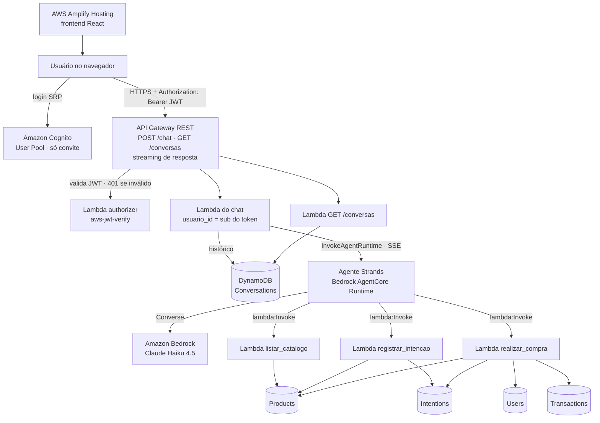

# Chatbot de Pagamentos na AWS (Desafio 1 · Pagamentos Agênticos · Sprint 2)

Chatbot com login que conversa com um agente de IA e realiza compras simuladas (cartão ou Pix) por meio de três ferramentas. Na Fase 1 tudo rodava local (Ollama, Postgres, MCP por stdio); agora roda na AWS, com infraestrutura como código (AWS CDK).

As regras de negócio **não mudaram**: catálogo, intenção de compra, compra com cartão ou Pix, limite por usuário e validação da intenção.

> O código da Fase 1 está preservado em [`fase1/`](fase1/) apenas como referência.

**App publicado:** `https://COLE-AQUI-A-URL-DO-AMPLIFY`

---

## 1. Arquitetura (como foi implementada)



**Variação em relação ao desenho de referência (justificada):**

- **API Gateway REST (e não HTTP API).** O desafio exige resposta em *stream* ou WebSocket. O streaming de resposta do API Gateway só existe para REST APIs (`responseTransferMode: STREAM`), não para HTTP APIs.
- **Lambda authorizer com `aws-jwt-verify` (em vez do authorizer nativo do Cognito).** Valida o JWT do Cognito (assinatura, expiração, emissor e client) e aceita exatamente o formato `Authorization: Bearer <token>` pedido no enunciado. Sem token, ou com formato inválido, o próprio API Gateway responde 401 (`validationRegex`); com token inválido/expirado o authorizer nega e o gateway responde 401. Nada disso chega à Lambda do chat.
- As tools são Lambdas chamadas diretamente pelo agente (`lambda:InvokeFunction`), sem AgentCore Gateway (extra opcional).

Estrutura do repositório:

```
frontend/   React + Vite, Amplify Auth (Authenticator com hideSignUp), consome o stream
api/        Lambdas da API: authorizer, chat (streaming), conversas
agent/      Agente Strands (Python) implantado no AgentCore Runtime
tools/      Lambdas das 3 ferramentas (listar_catalogo, registrar_intencao, realizar_compra)
infra/      AWS CDK (TypeScript): Cognito, DynamoDB, Lambdas, API Gateway, AgentCore, IAM
fase1/      Código da Fase 1 (referência)
```

## 2. Deploy passo a passo

### Pré-requisitos

- Conta AWS com usuário/perfil IAM para deploy (não use a conta root) e **alerta no AWS Budgets** criado antes do primeiro deploy.
- Região **us-east-1** para tudo.
- Acesso ao modelo no Amazon Bedrock confirmado em us-east-1 (testar no Playground).
- Node.js 22+, Python 3.12+ com `pip` (para empacotar o agente em ARM64), AWS CLI v2 configurada (`aws configure` ou `aws configure sso`), Git.

### Passos

```bash
# 1) Dependências da infraestrutura e das Lambdas
npm ci

# 2) Bootstrap do CDK (uma vez por conta/região)
npx cdk bootstrap aws://SEU_ACCOUNT_ID/us-east-1

# 3) Primeiro deploy (CORS temporário para localhost)
npx cdk deploy

# 4) Crie o app no Amplify (console) conectando este repositório, pasta raiz "frontend"
#    -> anote a URL, ex.: https://main.d1a2b3c4d5.amplifyapp.com

# 5) Redeploy restringindo o CORS à origem do Amplify
npx cdk deploy -c frontendOrigin=https://main.d1a2b3c4d5.amplifyapp.com

# 6) No Amplify: Hosting > Environment variables, cadastre as saídas do deploy:
#    VITE_API_URL, VITE_USER_POOL_ID, VITE_USER_POOL_CLIENT_ID  -> redeploy do front

# 7) Crie usuários (cadastro só por convite)
aws cognito-idp admin-create-user --region us-east-1 \
  --user-pool-id <UserPoolId> --username email@exemplo.com \
  --user-attributes Name=email,Value=email@exemplo.com Name=email_verified,Value=true \
  --desired-delivery-mediums EMAIL
```

Detalhes e solução de problemas: ver o guia que acompanha o projeto.

## 3. Modelo do Bedrock

**Claude Haiku 4.5**, pelo perfil de inferência geo-US `us.anthropic.claude-haiku-4-5` (em us-east-1 o modelo só está disponível via perfil de inferência entre regiões). É o modelo recomendado no enunciado: baixo custo, baixa latência e bom desempenho em *tool calling*. Pode ser trocado sem editar código: `npx cdk deploy -c modelId=<id-do-perfil>`.

## 4. Modelagem do DynamoDB

Todas as tabelas são on-demand (`PAY_PER_REQUEST`). Dinheiro é guardado em **centavos (inteiro)** para evitar erro de ponto flutuante.

| Tabela | Chave | O que guarda |
|---|---|---|
| `Users` | PK `userId` (= `sub` do Cognito) | `availableLimitCents` (limite disponível), `createdAt`. Criado na primeira compra, com limite padrão de R$ 5.000,00. |
| `Conversations` | PK `userId`, SK `conversationId` (`default`) | `messagesJson` (histórico completo no formato do Strands/Converse, incluindo chamadas de ferramenta), `updatedAt`. |
| `Products` | PK `productId` | `name`, `priceCents`, `currency`, `stock`, `category`. Catálogo inicial gravado pelo CDK. |
| `Intentions` | PK `intentionId` | `userId`, `productId`, `quantity`, `unitPriceCents`, `totalCents`, `currency`, `status` (`pendente`/`paga`), `expiresAt` (epoch ms), `createdAt`, `paidAt`, `paymentMethod`. |
| `Transactions` | PK `intentionId` | `transactionId`, `userId`, `amountCents`, `currency`, `paymentMethod`, `status`, `createdAt`. A chave ser o `intentionId` garante **no máximo uma transação por intenção**. |

**Sem duplicidade (escritas condicionais).** `realizar_compra` faz uma única `TransactWriteItems` (tudo ou nada) com 4 operações condicionais: (0) intenção só vira `paga` se estiver `pendente`, for do usuário e não tiver expirado; (1) o limite só é debitado se `availableLimitCents >= valor`; (2) o estoque só baixa se `stock >= quantidade`; (3) a transação só é criada se ainda não existir para aquela intenção. Se a mesma chamada chegar duas vezes (inclusive em paralelo), só uma efetiva; a outra recebe `INTENCAO_JA_PAGA`.

**Limites conhecidos:** a conversa de cada usuário é um único item (máx. 400 KB; acima de ~300 KB os turnos mais antigos são descartados). O catálogo usa `Scan` (adequado para poucos produtos).

## 5. Permissões IAM (menor privilégio)

| Role | Pode | Não pode |
|---|---|---|
| Lambda do chat | `bedrock-agentcore:InvokeAgentRuntime` **só neste runtime**; `GetItem`/`PutItem` **só em Conversations** | Bedrock; tabelas Intentions/Transactions/Users/Products |
| Lambda `GET /conversas` | `GetItem` só em Conversations | Qualquer outra coisa |
| Lambda authorizer | Apenas logs (política gerenciada `AWSLambdaBasicExecutionRole`) | Acesso a dados |
| Runtime do AgentCore | `bedrock:InvokeModel*` **só no modelo escolhido** (perfil + modelo base nas 3 regiões do perfil US); `lambda:InvokeFunction` **só nas 3 tools**; logs/métricas do runtime e leitura do pacote de código (adicionados pelo construct L2 do CDK) | Acesso direto às tabelas |
| `listar_catalogo` | `Scan` em Products | Escrita; outras tabelas |
| `registrar_intencao` | `GetItem` em Products; `PutItem` em Intentions | Outras tabelas/ações |
| `realizar_compra` | `GetItem`/`UpdateItem` em Intentions e Products; `GetItem`/`PutItem`/`UpdateItem` em Users; `PutItem` em Transactions | Qualquer ação fora dessas |

Nenhuma política usa `Action: "*"` com `Resource: "*"` nem políticas gerenciadas amplas. Exceções documentadas: as ações `xray:*` e `cloudwatch:PutMetricData` que o construct L2 do AgentCore acrescenta à role do runtime não aceitam permissão por recurso (exigem `*`), mas são ações específicas de telemetria. A origem dessas regras está em [`infra/lib/backend-stack.ts`](infra/lib/backend-stack.ts).

**Regras de segurança preservadas:** o `usuario_id` vem do `sub` do token validado (nunca do corpo da requisição nem de argumento do modelo; é injetado dentro das funções de ferramenta do agente); o valor da compra vem da intenção gravada; `realizar_compra` só aceita intenções do próprio usuário, ainda não pagas e não expiradas.

## 6. Evidências

> Substitua pelos seus prints/vídeo (pasta `docs/evidencias/`).

- Login: `docs/evidencias/login.png`
- Chamada sem token rejeitada com 401: `docs/evidencias/401.png`
- Compra com cartão: `docs/evidencias/compra-cartao.png`
- Compra com Pix: `docs/evidencias/compra-pix.png`
- Tentativa bloqueada por limite excedido: `docs/evidencias/limite-excedido.png`
- Tentativa com `intencao_id` inválido: `docs/evidencias/id-invalido.png`

## 7. Como remover todos os recursos

```bash
# 1) Backend (API Gateway, Lambdas, tabelas, Cognito, runtime do AgentCore, roles)
npx cdk destroy

# 2) Frontend: Console AWS > AWS Amplify > seu app > App settings > General settings > Delete app

# 3) Resíduos fora da stack: confira e apague no console
#    - CloudWatch > Logs > Log groups: /aws/bedrock-agentcore/runtimes/*  e /aws/lambda/*
#    - S3: bucket de assets do CDK (cdk-hnb659fds-assets-...) -> esvazie e apague (ou delete a stack "CDKToolkit" por último)
#    - ECR: o bootstrap cria o repositório de imagens do CDK (cdk-hnb659fds-container-assets-...); apague se existir
#    - Budgets: remova o alerta se não for mais necessário
```
